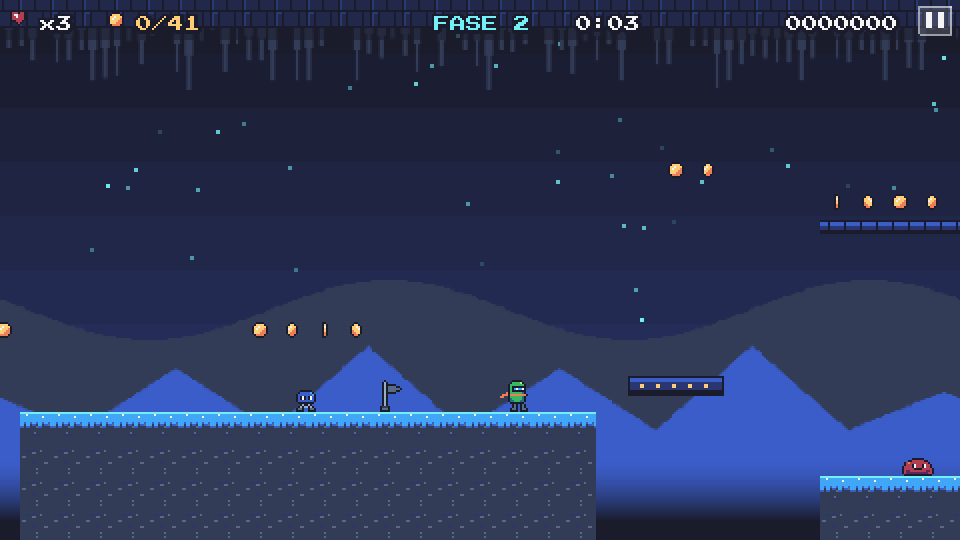

# Pixel Runner

Jogo de plataforma 2D em pixel art feito para o navegador com **Phaser 3**, **TypeScript** e **Vite**.
Projeto de portfólio de **Arthur Souza Soares**.

### ▶️ Jogue agora: **https://arthursouzas.github.io/pixel-runner**


| Menu | Fase 2 — Caverna de Cristal |
| :---: | :---: |
|  |  |
| **Arena do chefe** | **Vitória** |
|  |  |

---

## Sobre o jogo

Você controla **Pix**, um pequeno robô corredor de capacete verde e cachecol laranja, em 5 fases de dificuldade crescente até enfrentar o **Núcleo Ancestral**, o chefe da fortaleza final.

Todo o visual e o som são gerados por código, sem arquivos de imagem ou áudio externos:

- **Sprites** desenhados como pixel art em texto (`src/gfx/sprites.ts`) e convertidos em texturas na inicialização.
- **Tiles e cenários** com parallax gerados proceduralmente para cada tema.
- **Efeitos sonoros e música** sintetizados em tempo real com a **Web Audio API**.

### Recursos

- Correr, pular (com altura variável, *coyote time* e *buffer* de pulo), **pulo duplo** e **dash**
- 5 fases: Campos Verdes, Caverna de Cristal, Fábrica Enferrujada, Picos Gelados e Fortaleza do Núcleo
- 4 tipos de inimigo com padrões diferentes: gosma (patrulha), saltador (pula em direção ao jogador), morcego (voo em "8") e torreta (atira)
- **Chefe** com várias fases de ataque: saltos com onda de choque, rajadas de tiros e investidas quando está enfurecido
- Moedas (vida extra a cada 50), checkpoints, plataformas móveis e espinhos
- Combo ao pisar em vários inimigos seguidos sem tocar o chão
- Bônus de tempo e de coleta de todas as moedas ao fim de cada fase
- Menu inicial, seleção de fases, pausa, vidas, placar e tela de fim de jogo
- **Recorde, fases desbloqueadas, melhores tempos e preferência de som salvos no `localStorage`**
- Partículas (poeira, brilhos, confete), rastro do dash e tremida de câmera
- **Controles por teclado** e **botões na tela** em celulares e tablets

## Controles

| Ação | Teclado | Toque |
| --- | --- | --- |
| Correr | `←` `→` ou `A` `D` | Setas na tela |
| Pular | `Espaço`, `W`, `Z` ou `↑` | Botão **A** |
| Pulo duplo | Pular de novo no ar | **A** no ar |
| Dash | `Shift`, `X` ou `K` | Botão **B** |
| Pausar | `Esc` ou `P` | Botão **II** |
| Ligar/desligar som | `M` | Menu de pausa |

Dica: pise nos inimigos ou acerte-os com o dash. O dash também atravessa projéteis. O chefe só é derrotado com pisões!

## Como rodar localmente

Requisitos: **Node.js 20+**.

```bash
npm install
```

```bash
npm run dev
```

Outros comandos:

| Comando | Descrição |
| --- | --- |
| `npm run dev` | Servidor de desenvolvimento em `http://localhost:5173/pixel-runner/` |
| `npm test` | Testes com Vitest |
| `npm run build` | Checagem de tipos + build de produção em `dist/` |
| `npm run preview` | Serve o build de produção localmente |

## Estrutura do código

```
src/
├── main.ts               # Configuração do Phaser e inicialização
├── scenes/               # Cenas: Boot, Menu, LevelSelect, Level (Fase), HUD, Pause, GameOver
├── levels/               # Fases em arquivos de dados (mapas ASCII + plataformas móveis + dicas)
├── logic/                # Lógica pura, sem Phaser (testada com Vitest)
│   ├── score.ts          #   pontuação, vidas, combos e bônus
│   ├── progress.ts       #   desbloqueio e sequência de fases
│   ├── save.ts           #   leitura/escrita e validação do save
│   └── levelParser.ts    #   conversão do mapa ASCII em dados
├── objects/              # Player, inimigos, chefe e plataformas móveis
├── gfx/                  # Paleta, sprites em pixel art e geração de texturas
├── audio/                # Efeitos e música com Web Audio
├── input/                # Estado dos controles de toque
├── systems/              # Ponte entre o save e o localStorage
└── ui/                   # Texto pixelado e menus navegáveis
tests/                    # Testes do Vitest
```

### Formato das fases

Cada fase é um arquivo em `src/levels/` com um mapa ASCII de 17 linhas:

| Caractere | Significado |
| --- | --- |
| `#` | Chão (o topo é escolhido automaticamente) |
| `X` | Bloco sólido |
| `-` | Plataforma atravessável por baixo |
| `^` | Espinhos |
| `o` | Moeda |
| `P` / `G` | Início / chegada |
| `K` | Checkpoint |
| `w` `h` `b` `t` | Gosma, saltador, morcego, torreta |
| `B` / `\|` | Chefe / portão da arena |

Plataformas móveis e dicas de tutorial ficam em listas separadas no mesmo arquivo. Os testes verificam se todas as fases são válidas (início, chegada, chão sob o jogador etc.).

## Publicação

O deploy é feito automaticamente no **GitHub Pages** pelo workflow `.github/workflows/deploy.yml` a cada push na `main`: ele instala as dependências, roda os testes, gera o build (com `base: "/pixel-runner/"`) e publica a pasta `dist/`.

> Na primeira vez, ative em **Settings → Pages → Build and deployment → Source: GitHub Actions**.

## Créditos

- Código, design de fases, pixel art e sons: **Arthur Souza Soares**
- Fonte [Press Start 2P](https://fonts.google.com/specimen/Press+Start+2P) (SIL Open Font License), empacotada via `@fontsource`
- Feito com [Phaser 3](https://phaser.io), [TypeScript](https://www.typescriptlang.org) e [Vite](https://vite.dev)

Licença MIT.
